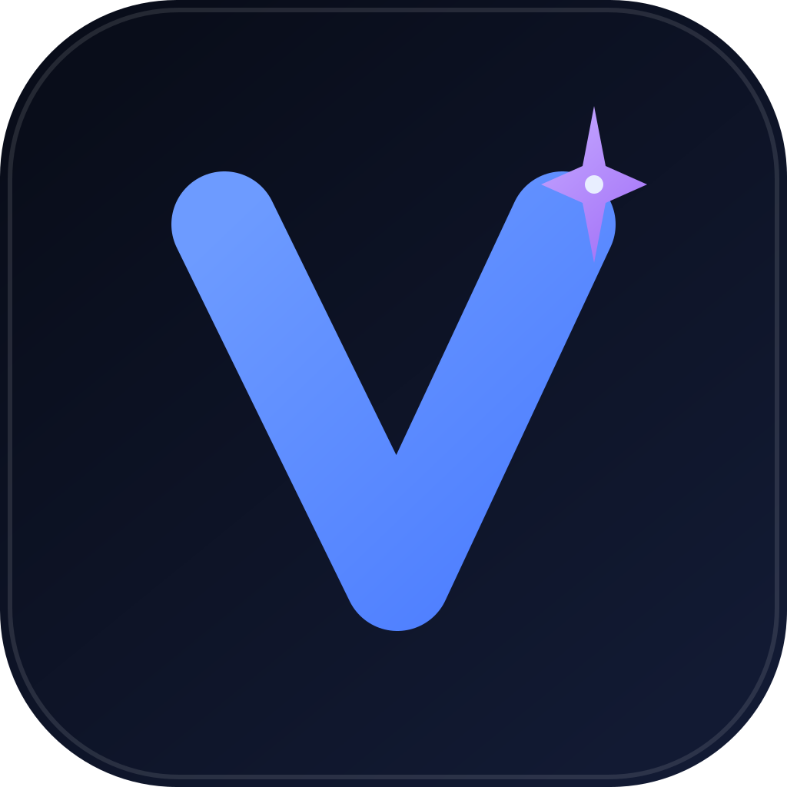
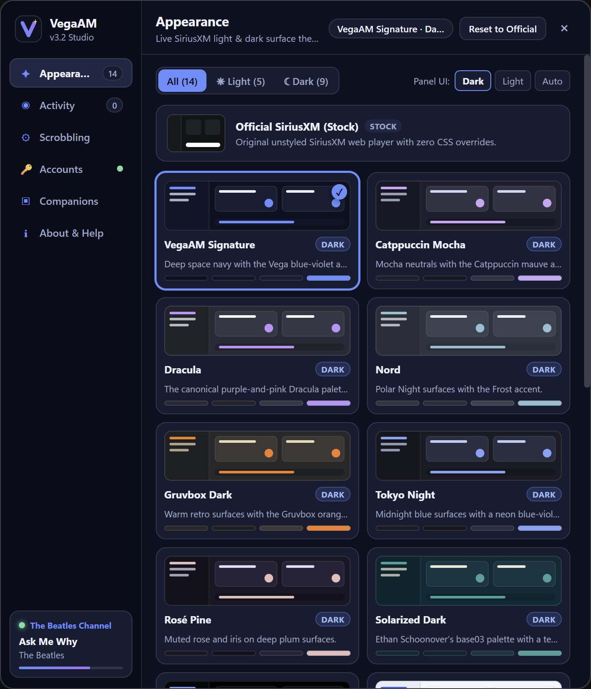
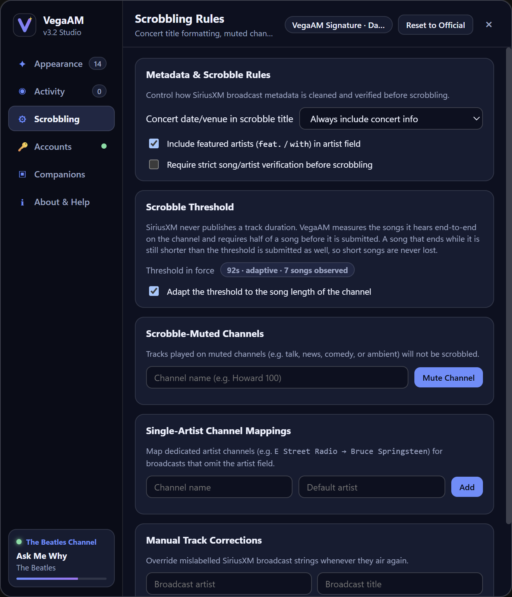
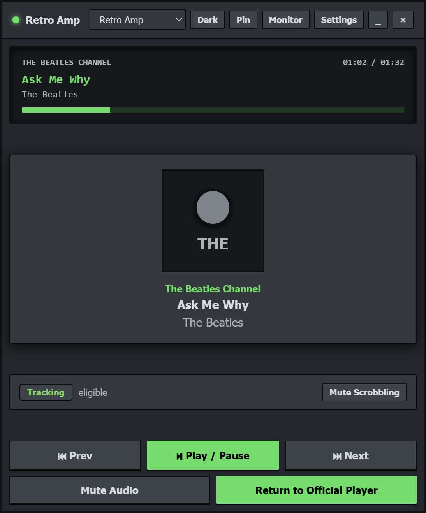
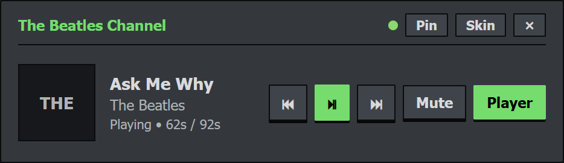
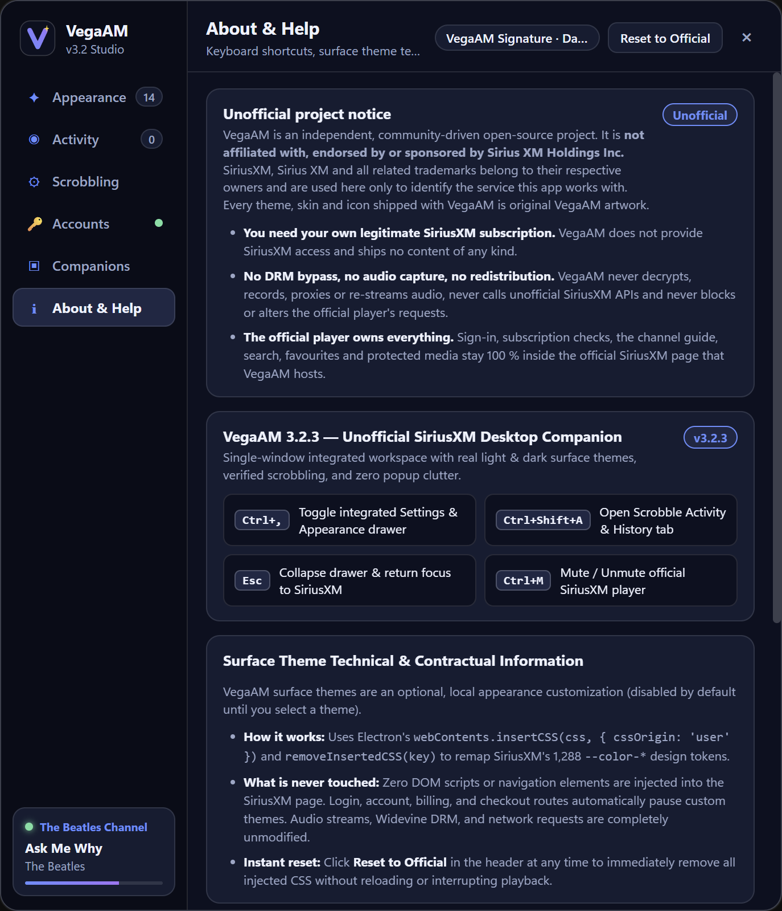

<div align="center">



# VegaAM

**An unofficial, open-source desktop companion for the official SiriusXM web player.**

Reversible light & dark surface themes · integrated studio drawer · Last.fm & ListenBrainz scrobbling · mini-player and desktop integration.

[](LICENSE)


</div>

---

## ⚠️ Please read this first

**VegaAM is an unofficial, independent, open-source project.** It is *not* affiliated
with, endorsed by, sponsored by, or in any way officially connected to Sirius XM
Holdings Inc., Sirius XM Radio, or any of their subsidiaries. "SiriusXM", "Sirius XM",
the SiriusXM logo and all related trademarks, service names and artwork are the
property of their respective owners and are used here only to identify the service
that this software works with. Every theme, icon and graphic shipped with VegaAM is
original VegaAM artwork.

**You need your own legitimate SiriusXM subscription.** VegaAM does not provide
SiriusXM access, does not unlock channels, and does not include any content. It only
hosts the official SiriusXM web player and gives you a nicer desktop shell around it.
If you do not have a subscription, VegaAM will show you exactly what the official
player shows you.

**VegaAM does not decrypt, capture, proxy, record or redistribute audio.** There is no
DRM circumvention, no stream interception, no ad blocking and no unofficial streaming
endpoint anywhere in this codebase. What the official player plays, it plays — with
the official player's own DRM and the official player's own network requests. See
[`docs/SECURITY.md`](docs/SECURITY.md) and [`docs/LIMITATIONS.md`](docs/LIMITATIONS.md)
for the exact technical boundary.

By using VegaAM you agree to the
[SiriusXM Customer Agreement](https://www.siriusxm.com/legal/customeragreement) and
the [SiriusXM Website Terms of Use](https://www.siriusxm.com/legal/website_terms),
as well as the terms of the scrobbling services you connect to.

---

## Screenshots

| Integrated studio drawer — Appearance | Scrobbling Rules |
| :---: | :---: |
|  |  |

| Skinned companion — Retro Amp | Compact mini-player |
| :---: | :---: |
|  |  |

| About & Help — the unofficial-project notice |
| :---: |
|  |

> All screenshots show **VegaAM's own interface** and were produced with the
> documentation screenshot generator (`npm run screenshots`), which renders the UI
> with mocked state. No SiriusXM page, artwork, channel data or account data is
> included. The SiriusXM content itself is © Sirius XM Holdings Inc. and is not
> redistributed here.

---

## What VegaAM adds to the official player

VegaAM is a **desktop shell**, not a replacement. The official SiriusXM web player
loads directly in the main window and keeps 100 % of its own playback, sign-in,
subscription checks, channel guide, search, favourites and protected media. VegaAM
adds the parts a desktop app should have.

### ✨ 14 reversible surface themes (9 dark + 5 light)

Themes are applied to the official page with Electron's
`webContents.insertCSS(css, { cssOrigin: 'user' })` and removed again with
`removeInsertedCSS(key)`. **No DOM scripts are injected, nothing is rewritten, no
request is modified, and playback is never interrupted.** One click on *Reset to
Official* restores the stock appearance instantly.

| Dark | Light |
| :--- | :--- |
| VegaAM Signature (`vega`) | VegaAM Light (`vega-light`) |
| Catppuccin Mocha (`catppuccin`) | Catppuccin Latte (`catppuccin-latte`) |
| Dracula (`dracula`) | Nord Light (`nord-light`) |
| Nord (`nord`) | Solarized Light (`solarized-light`) |
| Gruvbox Dark (`gruvbox`) | Rosé Pine Dawn (`rose-pine-dawn`) |
| Tokyo Night (`tokyo-night`) | |
| Rosé Pine (`rose-pine`) | |
| Solarized Dark (`solarized`) | |
| OLED Black (`oled`) | |

Plus **Official (Stock)** and optional `#RRGGBB` custom-accent derivation with live
preview. Theming is **off by default** and requires explicit consent; the stylesheet
is automatically stripped on sign-in, account, billing and checkout routes so it can
never interfere with a purchase flow.

Light palettes are genuine daylight palettes, not inverted dark themes. They are
alpha-aware: because SiriusXM paints many labels with translucent tokens, a colour
that passes contrast at full opacity can still fail once composited, so each
text-bearing role is corrected against every surface it can sit on.

### 🖥️ 5 companion skins

The optional **Skinned Companion** window renders your now-playing track in a full
VegaAM skin: `Bluebird Classic`, `Retro Amp`, `Modern`, `Retro Satellite` and
`Classic Compact`, each in light and dark mode. These are original VegaAM designs
inspired by classic hi-fi equipment — they are **not** SiriusXM themes and contain no
SiriusXM artwork.

### 📻 Mini-player and desktop integration

- **Compact Companion** (`480×152`) — a mini-player with artwork, channel, track,
  scrobble progress and a mute toggle.
- **Quick orb** — a floating always-on-top launcher for the integrated drawer.
- **Integrated studio drawer** — Appearance, Activity & History, Scrobbling Rules,
  Accounts, Companions & Desktop and About & Help all open **inside the main window**
  as a single `WebContentsView`. VegaAM never spawns popup windows for settings.
- **Native integration** — OS media panels (Windows GSMTC / macOS Now Playing /
  Linux MPRIS), media keys, tray icon, desktop notifications, global shortcuts and
  start-with-OS, each gated behind a capability check.
- **Windows icon identity** — a proper multi-size V-star in the taskbar, the tray,
  the Start Menu and the installer, with automatic cleanup of stale legacy shortcuts.

### 🎵 Scrobbling that respects the 50 % rule

- **Last.fm** via the official desktop authorization flow — a loopback callback, no
  manual session key, session restored after a restart.
- **ListenBrainz** with a user token, `playing_now` and `single` submissions.
- **Adaptive scrobble threshold.** SiriusXM publishes no track duration, so VegaAM
  measures the songs it hears end-to-end, takes the median of the last 12 songs and
  applies the same **50 % rule** Last.fm uses. A short punk song that ends while it is
  still under the threshold is **submitted** with the length it actually had. Paused
  and unobserved time never counts, and an absolute 30-second floor of real playback
  always applies — nothing you barely heard is scrobbled.
- **Metadata hygiene** — broadcast strings are separated into artist/title/quality
  markers, non-music bumpers and hashtag promos are rejected rather than guessed, and
  every correction you make is explicit and reversible.
- **Retry queue and history** — failed submissions are queued, bounded and retried;
  nothing is silently dropped.

---

## Requirements

- **Windows 10/11**, **macOS 11+**, or a modern **Linux** desktop (GTK 3).
- **Node.js 20+** and npm, *if* you want to build from source. Prebuilt installers do
  not need it.
- **A legitimate SiriusXM subscription** and a browser-like network connection.

## Installation

### Windows

Download the **NSIS installer** (`VegaAM-<version>-x64.exe` or `-arm64.exe`) from the
[Releases](https://github.com/dazzlejacket/VegaAM/releases) page, run it and pick
your install directory. The installer creates a Start Menu and Desktop shortcut.

### macOS

Download the `.dmg` (or the `.zip`), drag **VegaAM** into `/Applications` and launch it.
The published artifacts are **not code-signed**, so Gatekeeper will ask you to confirm
the first launch — right-click the app and choose **Open** if it refuses. macOS will also
ask for permission to use the Keychain the first time, because that is where the Last.fm
session key is stored. See [`docs/MACOS_KEYCHAIN.md`](docs/MACOS_KEYCHAIN.md).

### Linux

Download the **AppImage** (or the `.deb` / `.rpm`) and run it. The AppImage needs no
installation:

```sh
chmod +x VegaAM-<version>-x86_64.AppImage
./VegaAM-<version>-x86_64.AppImage
```

<details>
<summary>Deb / RPM dependencies</summary>

`libgtk-3-0`, `libnotify4`, `libnss3`, `libxss1`, `libxtst6`, `xdg-utils`,
`libatspi2.0-0`, `libsecret-1-0`.

</details>

---

## Building from source

```sh
git clone https://github.com/dazzlejacket/VegaAM.git
cd VegaAM
npm ci
npm run typecheck
npm test
npm run build
npm start
```

### Per-platform packaging

| Platform | Command | Notes |
| :--- | :--- | :--- |
| Windows | `npm run dist -- --win --x64` | NSIS installer. Use `--arm64` for the ARM build. |
| macOS | `npm run dist -- --mac` | Must run **on macOS** (DMG/ZIP, signing + notarization). |
| Linux | `npm run dist -- --linux` | Must run **on Linux** (AppImage, deb, rpm). |

Isolated single-architecture configs are available for Windows:

```sh
node build/electron-builder.cjs --config build/electron-builder.x64.yml
node build/electron-builder.cjs --config build/electron-builder.arm64.yml
```

Full details, toolchain notes and the live acceptance harness are in
[`docs/BUILD.md`](docs/BUILD.md).

### Project layout

```
src/
  main/        Electron main process: window, tray, drawer, themes, scrobbling, IPC
  preload/     Context-isolated preloads (app API + read-only MediaSession bridge)
  renderer/    VegaAM-owned UI: studio drawer, quick orb, companion windows
  core/        Pure, testable logic: themes, metadata, scrobble policy, settings
  shared/      Types shared across processes
build/         esbuild build script, electron-builder configs, icons, entitlements
scripts/       Deterministic icon generation and verification
tests/         Vitest unit + integration suite
docs/          Architecture, security, limitations, build and scrobbling docs
assets/        Original VegaAM brand artwork and screenshots
```

---

## Connecting Last.fm / ListenBrainz

VegaAM **never ships anybody's Last.fm API credentials** in this repository, and
[Last.fm's API terms](https://www.last.fm/api/tos) expect each application to
identify itself with its own key pair. This build therefore asks you for your own.

**Last.fm**

1. Register an application at
   [Last.fm API account creation](https://www.last.fm/api/account/create) — it only
   takes a minute and requires a Last.fm account.
2. In VegaAM open **Settings → Scrobbling Rules → Accounts**, enter the application's
   **API key** and **shared secret**.
3. Click **Connect Last.fm**, approve the request in the browser window that opens,
   and VegaAM exchanges the token for a session by itself.

Your session key is stored in the operating system key store (DPAPI on Windows, the
Keychain on macOS, a supported key ring on Linux) — never in plain text, and never
sent anywhere except to Last.fm.

> Maintainers who want to bake credentials into their **own** private build can set
> `VEGAAM_LASTFM_API_KEY` and `VEGAAM_LASTFM_API_SECRET` in the environment or in a
> git-ignored `.env.local`. The build injects them into the main-process bundle only.
> Do **not** commit them. See [`.env.example`](.env.example) and
> [`docs/SECURITY.md`](docs/SECURITY.md).

**ListenBrainz**

1. Create a token at [listenbrainz.org/settings](https://listenbrainz.org/settings/).
2. Paste it into **Settings → Accounts**. It is stored encrypted like the Last.fm
   session.

---

## What VegaAM deliberately does not do

These are hard design constraints, not missing features:

- ❌ No DRM circumvention, Widevine bypass or key extraction.
- ❌ No audio capture, recording, streaming relay or redistribution.
- ❌ No unofficial SiriusXM API calls, token reuse or reverse engineering.
- ❌ No scraping of the channel catalog, search results, favourites or schedules.
- ❌ No injecting scripts or DOM manipulation into the official page.
- ❌ No ad blocking, device spoofing, region shifting or entitlement spoofing.
- ❌ No bundling of SiriusXM credentials, logos, artwork or channel data.
- ❌ No bundling of anyone else's Last.fm application credentials.

The full technical and contractual boundary is documented in
[`docs/SECURITY.md`](docs/SECURITY.md), [`docs/LIMITATIONS.md`](docs/LIMITATIONS.md)
and [`docs/AUTHENTICATION.md`](docs/AUTHENTICATION.md).

---

## Contributing

Contributions are welcome — themes, skins, metadata rules, platform fixes and
documentation all help. Please read [`CONTRIBUTING.md`](CONTRIBUTING.md) first, and
keep the service boundary above intact: **a pull request that decrypts, captures or
redistributes audio will not be merged.**

## License

MIT — see [`LICENSE`](LICENSE). The original VegaAM branding (the V-star mark, the
wordmark and the generated icon set) is original work and is released under the same
license. Third-party trademarks mentioned in this repository remain the property of
their respective owners; see [`NOTICE.md`](NOTICE.md).

## Acknowledgements

- The [Electron](https://electronjs.org/) and [Chromium](https://www.chromium.org/)
  projects, and the enormous open-source ecosystem behind them.
- [Vitest](https://vitest.dev/), [esbuild](https://esbuild.github.io/),
  [electron-builder](https://www.electron.build/) and [TypeScript](https://www.typescriptlang.org/).
- The [Catppuccin](https://catppuccin.com/), [Nord](https://www.nordtheme.com/),
  [Dracula](https://draculatheme.com/), [Gruvbox](https://github.com/morhetz/gruvbox),
  [Tokyo Night](https://github.com/enkia/tokyo-night),
  [Rosé Pine](https://rosepinetheme.com/) and
  [Solarized](https://ethanschoonover.com/solarized/) theme authors, whose open
  palettes the surface themes are built on.
- The Last.fm and ListenBrainz APIs, and the people who maintain them.
